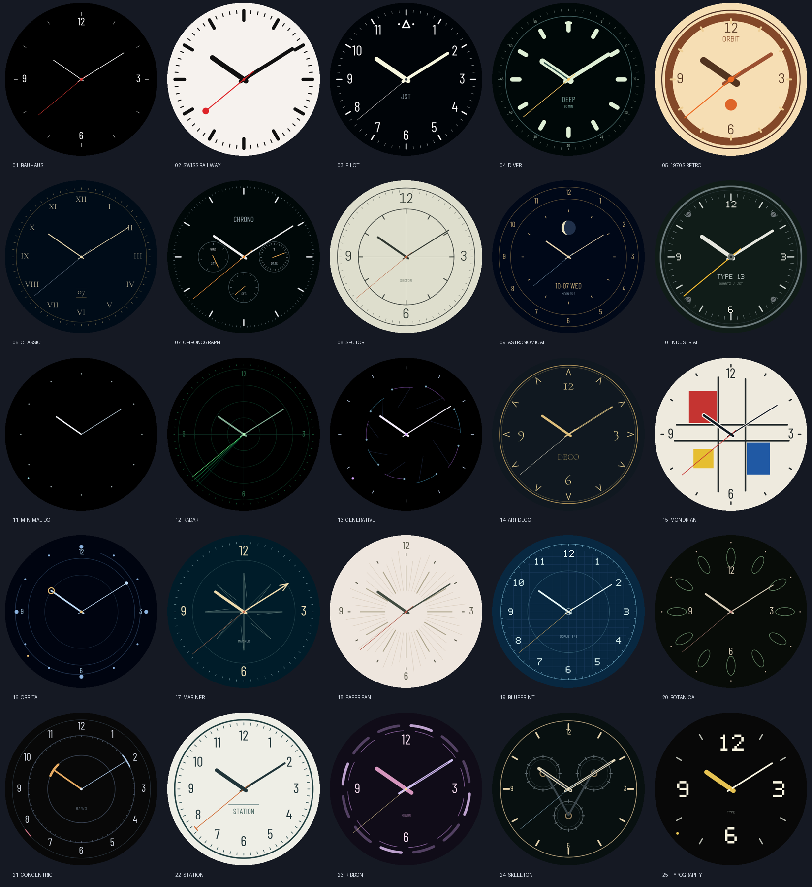

# TWENTY-FIVE — 25種類のアナログ置き時計

**Waveshare ESP32-S3-Touch-AMOLED-1.75（Cなし）専用**、466×466円形AMOLED、16MB Flash、8MB Octal PSRAM。ESP-IDF **5.5.x**（この環境では **v5.5.5**）を使用します。1.75C用ではありません。

25種類の12時間式文字盤を日付から決定論的に割り当て、毎正時に切り替えます。Wi-Fiがなくても、有効なRTC時刻から起動して時計を継続します。



## ビルドせずにインストールする（Releases配布版）

**[Releasesのビルド済みZIP](https://github.com/hiroikezawa/twenty-five-clock/releases/latest)を使えば、ESP-IDFの導入もコンパイルも不要です。** リポジトリは [hiroikezawa/twenty-five-clock](https://github.com/hiroikezawa/twenty-five-clock) です。非公開の間は、アクセス権のあるGitHubアカウントでログインしてください。以下は配布ZIPを取得したあとの手順です。

### 用意するもの

- **Waveshare ESP32-S3-Touch-AMOLED-1.75（末尾Cなし、16MB Flash）**。1.75Cには使用できません。
- Windows / macOS / LinuxのPC、データ通信できるUSBケーブル。
- Python 3.10以降。WindowsではPythonのインストール時にPATHへ追加すると便利です。
- 時計が接続できる、インターネットに通じた**2.4GHz Wi-Fi**と、そのSSID・パスワード。

### Windowsで書き込む

1. リポジトリの **Releases → 対象バージョン → Assets** から **`clock-25faces-non-c-16mb.zip`** をダウンロードして展開します。GitHubが自動で付ける `Source code (zip)` はビルド済み配布物ではありません。
2. 時計をPCのUSBへ接続します。デバイスマネージャーの「ポート（COMとLPT）」でCOM番号を確認します。以下の `COM3` は実際の番号に置き換えてください。
3. 展開したフォルダーのうち **`flash.py` がある場所** でPowerShellを開き、以下を実行します。

```powershell
py -3 -m venv .venv
.venv\Scripts\python.exe -m pip install -r requirements-flash.txt
.venv\Scripts\python.exe flash.py --check
.venv\Scripts\python.exe flash.py --port COM3
```

仮想環境のactivateは不要です。`py` がない場合は、最初の行を `python -m venv .venv` にします。初回の書き込みツール取得にはPCのインターネット接続が必要です。書き込み前に、シリアルモニターやCOMポートを使用する他のアプリを閉じてください。

書き込み後は自動再起動します。次の「初回Wi-Fi設定」を行うと、起動時に日本時間を取得します。以降はUSB電源だけで運用でき、PCへの常時接続は不要です。

### macOS / Linuxで書き込む

```sh
python3 -m venv .venv
.venv/bin/python -m pip install -r requirements-flash.txt
.venv/bin/python -m serial.tools.list_ports
.venv/bin/python flash.py --check
.venv/bin/python flash.py --port /dev/ttyACM0
```

ポートはLinuxなら `/dev/ttyACM0`、macOSなら `/dev/cu.usbmodem...` など、一覧に表示されたものを指定します。LinuxでPermission deniedになる場合は、そのディストリビューションのシリアルポート権限を設定してください。

### 更新と接続トラブル

同じ時計ファームウェアの更新も、新しいZIPを展開して同じコマンドを実行します。書き込み対象はbootloader・partition table・applicationの3領域のみで、**保存済みWi-Fiと明るさのNVS領域は消去しません**。別のファームウェアから移行する場合は、設定の引き継ぎを保証しません。

- ポートが見つからない：データ対応USBケーブル、USB接続、デバイスマネージャーを確認します。
- 接続待ちで止まる：BOOTを押したままUSBを接続し、BOOTを離してポートを再確認してから書き込みます。完了後に通常起動しなければUSBを抜き差しします。
- 通信エラー：`flash.py --port COM3 --baud 115200` で速度を落とします。
- ZIPが壊れている：`--check` が各バイナリのSHA-256とサイズを検査します。失敗したら再ダウンロードしてください。

書き込みには [Espressif公式esptool 4.x](https://docs.espressif.com/projects/esptool/en/release-v4/esp32/installation.html) を使用します。NVSの初期化を伴う `erase_flash` は通常の更新では不要です。

## ソースからビルド・書き込み

ESP-IDF **v5.5.5** をインストールし、ESP-IDF環境を有効にしたターミナルでソースを取得します。Releasesのインストール手順だけを使う場合、この作業は不要です。

```sh
git clone https://github.com/hiroikezawa/twenty-five-clock.git
cd twenty-five-clock
```

ESP-IDF 5.5.xのターミナルを開き、このREADMEがあるフォルダーで実行します。

```sh
idf.py build
idf.py -p COM3 flash monitor
```

新しいチェックアウトでターゲットを明示する場合は、最初に `idf.py set-target esp32s3` を実行してください。monitor終了は `Ctrl+]`。依存コンポーネントは初回ビルド時に取得されるため、PCのインターネット接続が必要です。生成済み字体はソースに含まれており、PillowやVisual Studioはファームウェアのビルドには不要です。

Windowsの今回の環境用補助スクリプトは `tools/idf-build.ps1` です。標準のESP-IDFターミナルでは上記の `idf.py` コマンドだけで構いません。

設定は `sdkconfig.defaults`、`main/Kconfig.projbuild`、`partitions.csv`。**Flashは16MB固定**とし、32MBを選ぶとソースのコンパイル時チェックでも停止します。NVSは0x9000から24KiB、factoryアプリは0x10000から6MiB、残りは未割当です。OTA・ファイルシステムは使用しません。

**ビルドはこのREADMEのあるルートで実行**してください。旧1.75C用コード・32MB設定はビルドに含めません。

## 公式実装の調査

参照元は [Waveshare公式Cなしモデルのリポジトリ](https://github.com/waveshareteam/ESP32-S3-Touch-AMOLED-1.75)、固定コミット `e4344e70c2fa78a13e8a06566507f1ba8af6672a` です。調査内容と出典は [docs/HARDWARE.md](docs/HARDWARE.md) にまとめました。

| 機能 | 実装・接続 |
|---|---|
| CO5300 466×466 | QSPI CLK=38、CS=12、D0/1/2/3=4/5/6/7、RST=**39**、TE=13（予約・今回未使用） |
| CST9217 | I²C 0x5A、RST=**40**、INT=11、座標反転なし |
| 共通I²C | SCL=14、SDA=15、400kHz、バスを一度だけ初期化 |
| PCF85063 RTC | 0x51、24時間制・JST、発振停止フラグとカレンダーを検証 |
| AXP2101 | 0x34、ID確認、公式に従い未接続NTCのTS測定を無効化。電源レール・充電電流は変更しない |
| QMI8658 | 0x6B、±2g/125Hzで加速度測定。重力による任意角度補正、ジャイロは停止 |
| Wi-Fi | ESP32-S3内蔵2.4GHz、外付けGPIOなし |
| 輝度 | CO5300 DCS 0x51。GPIOバックライト/PWMは存在しない |

## 初回Wi-Fi設定

**`192.168.4.1` は時計自身の設定ページです。自宅Wi-Fiに接続したままでは開けません。先にスマートフォンまたはPCの接続先を、時計が出す `Clock-175-XXXX` へ切り替えてください。** この設定は原則として初回だけです。

| 入力する場所 | Wi-Fi名 | 入力するパスワード |
|---|---|---|
| スマートフォン/PCのWi-Fi設定 | 時計画面の `Clock-175-XXXX` | 時計画面の大きな文字、上段6文字＋下段6文字 |
| ブラウザーの時計設定ページ | 自宅ルーターの2.4GHz SSID | 自宅ルーターのWi-Fiパスワード |

この2種類のパスワードは別物です。ルーター管理画面のログインパスワードも使いません。

1. 初回は時計に `WI-FI SETUP` が表示されます。
2. スマートフォン/PCで画面の `Clock-175-XXXX` に接続します。WPA2パスワードは**起動ごとに生成**して画面に表示します。
   パスワードは読みやすい大きな文字で6文字ずつ2段表示します。**上段→下段を続けて12文字**入力し、空白や改行は入れません。設定画面を開いている間は輝度を最低65%にします。
3. 接続を維持したまま、ブラウザーの**アドレス欄**へ **http://192.168.4.1/** を入力します。検索欄や `https://` は使いません。自動で設定ページが開く仕組みではありません。
4. 日本語の設定ページでSSID欄を押し、時計が検出した自宅の2.4GHz Wi-Fiを選びます。候補にない場合はルーターの2.4GHz設定を確認してください。非公開SSIDは直接入力できます。自宅Wi-Fiのパスワード（時計の設定用パスワードとは別）を入力し、`保存して接続する`を押します。
5. NVSへ保存して時計が再起動します。設定ページや `Clock-175-XXXX` への接続が切れるのは正常です。スマートフォン/PCは自宅Wi-Fiへ戻してください。時計は登録したルーターへ接続してNTP同期し、正しい時刻を表示します。接続先パスワードはログへ出しません。

### 設定ページや時刻が表示されないとき

| 症状 | 確認・操作 |
|---|---|
| `192.168.4.1` に接続できない | 端末が `Clock-175-XXXX` に接続中か確認。「インターネットなし」でもその接続を維持。端末が自動で自宅Wi-Fiへ戻っていないか確認 |
| Wi-Fiのパスワードが通らない | 時計画面の上段→下段を空白なしで計12文字。時計を再起動すると設定用パスワードも変わるため、以前の値を使わない |
| 時計の接続先候補に自宅SSIDがない | ルーターの2.4GHzを有効にする。5GHz専用SSIDは使えない。ルーターに近づく。非公開SSIDは手入力 |
| `HOME WI-FI NOT FOUND` | 登録した自宅SSIDの綴り・大文字小文字と、2.4GHzの電波を確認し、タップして再設定 |
| 認証失敗 | ブラウザーには自宅ルーターのWi-Fiパスワードを入力。時計画面の設定用パスワードを入れていないか確認 |
| `TIME NOT SET` が続く | 画面をタップしてWi-Fiを再設定。Wi-Fi接続済みならルーターのインターネット接続、DNS、NTP（UDP 123）の利用可否を確認。1回の接続・時刻取得は最大約75秒、失敗時は再試行 |
| 電源を完全に切ると時刻が消える | RTCのバックアップ電源がなければ電源断中の時刻を保持できない。Wi-Fi登録を済ませておけば次の起動時にNTPで復帰。Wi-Fi設定自体は電源断後も保持 |

端末が時計APに接続しているのに設定ページだけ開けない場合は、VPNや通信を自動切替する機能の影響も確認してください。

SSIDは1〜32バイト、パスワードは8〜63バイト、オープンネットワークのみ空欄です。日本語などのSSIDはUTF-8バイト数で制限されます。設定用APは、端末に「インターネットなし」と表示されても接続を維持してください。

設定画面のCLOSEで時計へ戻れます。APは設定完了まで稼働します。あとでWi-Fiを変更する場合は、**長押し → WI-FI / TIME STATUS → CONFIGURE WI-FI**。既存認証情報の削除や再ビルドは不要です。

通常運用は起動時と同期時だけSTAを起動し、同期・タイムアウト後は無線を停止します。NVSは標準では暗号化されていません。設定用HTTPは専用WPA2 AP上だけで提供されます。

## 自動水平補正

QMI8658を25Hzで読み、重力に合わせて文字盤全体を任意角度で回転します。画面上の重力対応は公式non-C Gravitysphereと同じ（−accelY, +accelX）。数字・針・設定画面・タッチ座標を一緒に回転します。1.5度の不感帯、低域フィルタ、250ms間隔で微振動を抑え、タッチ中は向きを保持します。平置きに近く面内重力が0.3g未満の場合や急な振動中は最後の向きを保持します。重力だけでは平置き時の方位は分かりません。

背景は向きが変わった時だけバイリニア補間で回転・保存し、針は回転後の座標でアンチエイリアス描画します。通常フレームは変更タイルのみ転送。向きが変わる間は背景再生成・全画面転送のため一時的にフレーム間隔が延びます。

## 時刻・RTC・NTP

- 表示はAsia/Tokyo/JST固定（POSIX TZは `JST-9`）。サマータイムはありません。
- RTCは**JSTのカレンダー**を保存します。system time/NTPはUTCです。Waveshareのローカル時刻サンプルと同じ保存方針です。
- 起動時にLCD → RTC復元 → Wi-Fi/NTPタスク開始 → 現在の時刻に対応した文字盤表示。NTP待ちで時計を止めません。
- `ntp.nict.jp` と `pool.ntp.org` を使用。毎回の起動直後に同期を試み、成功後は既定6時間ごと。起動後5分間または時刻未設定中は失敗から30秒後、それ以降は15分後に再試行します。
- 日本向けチャンネル設定で全チャンネルを検索し、接続リトライを行います。接続待ち最大30秒、NTP待ち最大45秒で打ち切り。通信処理は描画ループから独立したタスクです。
- NTP成功時はsystem timeを補正し、PCF85063へ書き込み、最終同期日時をNVSへ保存します。
- RTCのSTOP/OSフラグ、BCD、日付を検証します。無効時は`TIME NOT SET`とWi-Fi設定案内を表示し、誤った時刻の針を出しません。内部の暫定日付2026-01-01や過去のNTP履歴を現在時刻とは扱いません。未同期中は夜間輝度にせず、昼の明るさで案内します。
- RTCのバックアップはボード電源回路に依存します。USBとバックアップ電源の両方を失いRTCが停止した場合は、次のNTP同期まで正しい時刻を復元できません。
- 設定画面のCurrent RTC Timeはsystem timeのコピーではなく、RTCを読み出した値です。

時刻未設定時と状態ページには、Wi-Fi接続中／NTP取得中／Wi-Fi未検出／認証失敗／時刻サーバー応答なしを区別して表示します。`HOME WI-FI NOT FOUND`は登録SSIDのアクセスポイントが見つからない状態で、NTPやRTCの故障を示しません。SSIDの大文字・小文字、2.4GHz有効設定、電波の届く範囲を確認してください。時刻未設定の画面はタップから直接Wi-Fi再設定へ進めます。

`idf.py menuconfig` → `Analog desk clock (non-C 1.75)` でNTP間隔を変更できます。

Wi-Fiを登録するまではインターネット時刻を取得できません。USB接続中はシリアルモニターを閉じて `python tools/sync_time.py --port COM3` を実行すると、PCの現在時刻をsystem timeとRTCへ設定できます（pyserialが必要、ESP-IDF環境に導入済み）。PCの時計が正しいことが前提です。次の起動からRTCの時刻を直ちに表示します。USB給電だけではPC時計は転送されません。Wi-Fi登録後はPCなしで起動時・定期NTP同期を行います。

USBシリアルで `SSID 新しいSSID` と改行を送ると、保存済みパスワードを維持したままSSIDだけを変更して再起動します。事前にパスワードがNVSに登録されている場合のみ利用できます。パスワードをPCへ読み出す操作はありません。

RTCが有効ならWi-Fi未設定でも時計画面を優先し、設定用APは裏で起動します。長押し→状態→CONFIGURE WI-FIからAP名とパスワードを確認できます。

## 25文字盤

| No. | 名称 | 特徴 | 秒表示 |
|---:|---|---|---|
| 01 | BAUHAUS | 黒、細い白針、四方だけの数字、広い余白 | 赤いSweep |
| 02 | SWISS RAILWAY | 白、太い黒目盛り・針、赤い丸マーカー、ロゴなし | Step |
| 03 | PILOT | 大きな数字、12時三角と左右の点、淡色の太い針 | Sweep |
| 04 | DIVER | 淡い夜光色、太い目盛り、外周60分、強調した12時 | Step |
| 05 | 1970S RETRO | クリーム/ブラウン、大きな環、幾何学針、Abel字体 | Sweep |
| 06 | CLASSIC | 濃紺、ローマ数字、セリフ字体、細い針、6時付近の日付 | Sweep |
| 07 | CHRONOGRAPH | 3時=日付、6時=秒、9時=曜日の実情報サブダイヤル | Sweep |
| 08 | SECTOR | 12時間式、淡い紙色、同心円と十字の区画、細身の針 | Sweep |
| 09 | ASTRONOMICAL | 月相/月齢、月日、曜日、通常の12時間インデックス | Sweep |
| 10 | INDUSTRIAL | チャコール、工業字体、4本のネジ装飾、太い計器針 | Step |
| 11 | MINIMAL DOT | 12個の点と2本の針だけ。秒は外周の小点 | Sweep dot |
| 12 | RADAR | 同心円、控えめな時分針、1分で1周する走査線 | Sweep |
| 13 | GENERATIVE | 日付・時・分から弧/線/点を生成、秒の小点、読みやすい針 | Sweep dot |
| 14 | ART DECO | 金色の山型インデックス、二重外周、装飾書体 | Sweep |
| 15 | MONDRIAN | 幾何学色面と格子、白縁の黒針 | Step |
| 16 | ORBITAL | 軌道リング、時針先端の輪、分針先端の点 | Sweep dot |
| 17 | MARINER | 羅針図の背景、矢印型分針、海洋計器風 | Step |
| 18 | PAPER FAN | 放射状の紙の折り目、余白のある中心、柔らかい紙色 | Sweep |
| 19 | BLUEPRINT | 設計図の格子、工業書体、細い製図線 | Step |
| 20 | BOTANICAL | 12枚の細長い花弁インデックス、落ち着いた針 | Sweep |
| 21 | CONCENTRIC | 時・分・秒で半径の違う短い弧と中央の針 | Sweep arc |
| 22 | STATION | 全12数字、緑黒の太い針、T字の秒針先端 | Step |
| 23 | RIBBON | ずらした二重の円弧インデックス、帯状の針 | Sweep |
| 24 | SKELETON | 歯車とブリッジを思わせる背景、中央の中抜き針 | Sweep |
| 25 | TYPOGRAPHY | 大きな12/3/6/9、短い太い時針、外周秒ドット | Step dot |

全文字盤の時針は12時間で1周します。旧24 HOURは削除し、CHRONOGRAPHとASTRONOMICALの24時間表示も置き換えました。


月相は2000-01-06 18:14 UTCの新月と平均朔望月29.530588853日による簡易計算です。天文暦の精密予測ではありません。ネット接続は不要です。Generativeは同じ日時なら同じ模様です。

## 毎正時の自動選択

`main/clock/schedule.c` の実装を使用します。

1. `YYYY-MM-DD` のASCIIからFNV-1aの32bit seedを生成。
2. 日番号mod25に対応する1種類を、その日の対象から外します。残る24種類をseed付きFisher–Yatesでシャッフルします。
3. 翌日に対象から外すFaceを当日の23時へ配置し、日付境界で同じFaceが連続しないようにします。
4. シャッフルした24種類を0〜23時に各1回ずつ割り当てます。同じ日なら再起動しても同じです。

1日の中で重複せず、任意の連続25日間では全Faceが各24回ずつ使われます。外すFaceと23時の境界条件は日替わりで、時刻だけによる固定順ではありません。過去の状態や再帰生成に依存しません。25種類すべてはタップ・スワイプで選択できます。

例：2026-10-07 14:37に起動すると、その日の14時の割当 **FACE 08 SECTOR** を14:37の通常の針位置で表示します。

## タッチ操作とNVS設定

| 操作 | 動作 |
|---|---|
| タップ | 次の文字盤。ダブルタップ判定のため約330ms待って確定 |
| 左スワイプ | 次の文字盤 |
| 右スワイプ | 前の文字盤 |
| ダブルタップ | Auto Face ChangeをONにし、その時刻の自動割当へ戻る |
| 約700ms長押し | 設定を開く/閉じる |
| 設定で左右スワイプ | 設定ページと状態ページを切替 |
| 設定のCLOSE | 時計へ戻る |

設定の輝度行は左側で−5、右側で＋5、範囲1〜100%。Sweep Seconds、Auto Face Changeの行はタップでON/OFF。変更はNVSへ保存します。Wi-Fi status、Last NTP Sync、Current RTC Timeは状態ページに表示します。

通常の手動切替は次の正時までの一時変更です。**Auto Face Changeを明示的にOFFにした場合のみ**正時の自動変更を止めます。OFF状態もNVSで保持。ダブルタップでONへ復帰します。再起動時はOFFでも現在時刻の割当を最初の表示に使います。

## 輝度と焼き付き対策

既定値は07:00〜18:59が85%、19:00〜22:59が65%、23:00〜06:59が30%。この改訂を初めて起動する時だけ、保存済みの暗い設定も85/65/30へ移行します。以後の手動調整は保持します。設定画面で各輝度を保存でき、完全消灯にはしません。初期値と開始時刻はmenuconfigまたは `sdkconfig.defaults` の `CONFIG_CLOCK_*` で変更できます。開始時刻はDay < Evening < Nightの順に指定します。移行後は保存済みNVS輝度が優先します。

文字盤全体（数字・目盛り・針・設定表示）は中心(233,233)からX/Y±3pxの範囲を120秒に1pxずつ移動し、文字盤変更時にも位置を変えます。最外周の描画は約218px以内に抑え、移動余裕を確保。静的背景の変更時は古い位置も消去します。文字盤変更・減光・位置移動で固定画素への負担を分散しますが、AMOLEDの経年劣化を完全に防ぐ保証ではありません。

## 描画と性能

- RGB565の元背景・回転後背景・動的フレームの3面を各466×466×2バイト、PSRAMに一度だけ確保。
- 32×32のdirty tileを追跡し、前回の針だけ背景から復元。現在の針と合わせた領域だけ転送。
- 横方向・縦方向の隣接dirty tileを、固定DMAバッファに収まる矩形へまとめて転送。余計な領域を増やさず転送待ち回数を削減し、末端も偶数座標/サイズに維持。
- 約29KiBの内部DMAバッファを使い、完了コールバックを待ってから再利用。PSRAMのバッファを転送中に書き換えない。
- 針・円・弧はcoverage AA、数字はOFL字体の4bit alpha。Industrialは独自の計器風bitmap字体。
- Sweepは16,667µs間隔（約60fps目標）で `gettimeofday()` のµsを角度へ反映。Stepは1秒単位。Sweep OFFでもStepに変更。
- 静的文字盤の再生成は位置移動・日付・文字盤/設定変更時。Generativeのみ毎分も再生成。レーダーの残光は4本の不透明線で表現。
- アプリケーションの毎フレームmalloc/freeなし。描画はCPU1、Wi-Fiは別タスク。タッチは10ms間隔で確認。
- 1分ごとのログにCurrent time、RTC status、NTP履歴、Current/Next Face、Brightness、Free heap、フレーム数、16.7ms超過回数、最大描画時間、転送画素数を出力。

**TEを使わない部分更新の見え方、発色/輝度、長期間の連続稼働は別途確認が必要です。** ホスト画像は実際のC描画コードから生成したものです。`CONFIG_CLOCK_SELF_TEST` を一時的にONにすると、起動時に25文字盤×120フレームの実機ベンチマークを実行します。出荷設定はOFFです。

COM3実機で37度回転後の描画＋転送を計測し、全3,000フレームが16,667µs以内でした。最大はCHRONOGRAPHの13,038µs、平均は3,640〜11,260µsです。時分針を10:09付近で分離し、秒針は全周を通過させ、QSPIは40MHzのまま測定しました。背景生成・回転角変更、Wi-Fi通信、タッチ処理は計測に含まれません。文字盤ごとの測定値は [docs/benchmark-25.json](docs/benchmark-25.json)、試験条件と限界は [docs/VALIDATION.md](docs/VALIDATION.md) を参照してください。

## 検証

ESP-IDF v5.5.5で `idf.py build` を実行して成功しています。検証記録は [docs/VALIDATION.md](docs/VALIDATION.md) にまとめています。生成物は `build/thirteen_clock.bin` とbootloader/partition tableです。

ホスト検証はVisual Studio 2022とPythonで実行します。

```powershell
cmd /c tools\host-build.cmd
python tests/test_schedule.py
python tests/test_render.py
python tests/test_rotation.py
python tests/test_twelve_hour.py
python tests/test_touch.py
python tools/render_faces.py
```

画像生成のみPillowが必要です。**製品と同じCソース**をDLLにして検証します。

- 2000〜2099年36,525日：再現性、24種類の非重複、25日間の均等性、隣接時間と日付境界の非重複、翌日の異なる順序。
- 全25文字盤×3位置×120フレーム＝9,000フレーム：dirty tile復元が毎回の完全描画とピクセル単位で一致。消し残しなし。
- 25文字盤×5角度×3位置×120フレーム＝45,000フレームの回転描画復元、および全25種類の10時と22時の針の一致を確認。
- タップ、ダブルタップ、長押し、左右スワイプ、縦ドラッグ、移動後の長押し抑止。ダブルタップ/長押し後に余分なタップを発生させないこと。

COM3のESP32-S3 rev0.2で書き込み・起動を実施しました。Flash16MB、PSRAM8MB、AXP2101、QMI8658加速度取得、CO5300、CST9217（466×466、Chip Type 0x9217）、設定用AP/DHCPを確認しています。USBでPCの現在時刻をRTCへ書き込み、再起動後のJST復元を確認しました。接続先SSIDを変更後、自宅Wi-Fi接続、IP取得、起動時NTP同期、RTC書込みの成功を実機で確認しました。長押しの設定画面からWi-Fiを登録してください。重力補正の物理方向・パネル表示・タッチ・長時間稼働の目視検証は、ログとホストテストとは区別してください。

## 新しいFaceの追加

`main/faces/face_bauhaus.c` を参考に、`face_example.c` に `clock_face_t` を実装します。静的な文字盤は `draw_static`、針と実時間情報は `draw_dynamic`。`init/deinit` は不要ならNULLです。時刻は引数で受け取り、描画中にネットワーク・NVS書込み・動的メモリ確保を行わないでください。

```c
const clock_face_t face_example = {
    .name = "EXAMPLE", .sweep = true, .background = 0x000000,
    .init = NULL, .draw_static = example_static,
    .draw_dynamic = example_dynamic, .deinit = NULL,
    .minute_cache = false
};
```

`face.h` へexternを追加し、`face_common.c` の `faces[]` に登録します。25種類を維持する場合は既存エントリーを置換してください。種類数自体を増やす場合は `face_count.h` のFACE_COUNTと `schedule.c` の25種類から1種類を外す割当、および検証コードを同時に更新します。新しいソースの検出には `idf.py reconfigure build` を実行します。ホスト用のビルドリストも `tools/host-build.cmd` に追加してください。

## ソース配置・ライセンス

`main/main.c` は起動処理のみ。`board/`、`display/`、`clock/`、`faces/`、`time/`、`touch/`、`settings/` へ分離しています。公式コードの参照元は [docs/HARDWARE.md](docs/HARDWARE.md) に記載しています。

Waveshare参照コードのライセンスは `docs/WAVESHARE-LICENSE`。字体はBarlow Condensed、Abel、Cormorant Garamond（SIL OFL、`tools/fonts/*-OFL.txt`）。再生成ツールは `tools/generate_fonts.py`。メーカーの商標・ロゴ画像は使用していません。

## Releasesの作成

ビルド後の `python tools/package_release.py` で配布ZIPとSHA256SUMSを生成します。GitHub ActionsはESP-IDF 5.5.5でビルドし、バージョンタグではDraft Releaseを作成する構成です。詳細は [docs/RELEASING.md](docs/RELEASING.md)。
